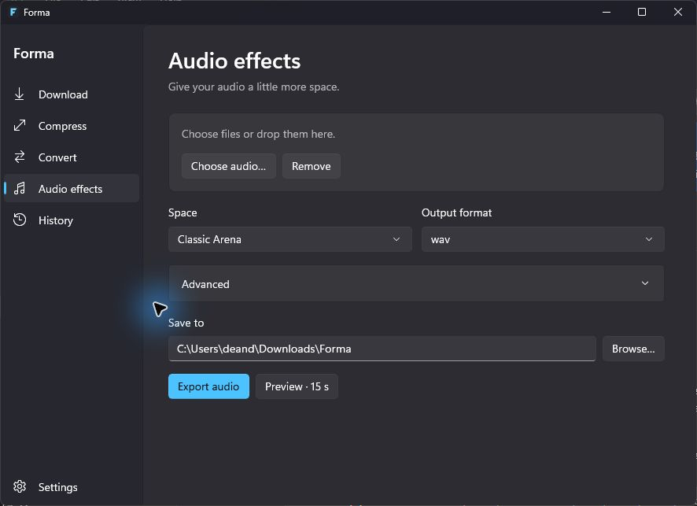

# Forma

A compact, native Windows 11 media utility. Download, compress, convert and shape audio in one local workspace. C# / .NET 10 / WinUI 3; no accounts, telemetry, recording or cloud processing.



## Run

Download the [latest Windows release](https://github.com/bethanian/Forma/releases/latest).

Extract the entire `Forma-1.0.0-win-x64.zip` folder and open `Forma.App.exe`. Keep its DLLs and resource folders together. The portable build includes .NET and Windows App SDK; it does not require a separate .NET installation. Windows 11 x64 is the supported target. The build is unsigned; no installer or automatic updater is included.

Install the external media tools explicitly, from a PowerShell terminal:

```powershell
winget install --id Gyan.FFmpeg --exact --source winget
winget install --id yt-dlp.yt-dlp --exact --source winget
winget install --id DenoLand.Deno --exact --source winget
```

Restart Forma after installation. Settings → Dependencies checks executable versions and locations. Tools are resolved from the configured folder, `tools` beside the executable, and the current/user/machine PATH. Use official yt-dlp Windows builds, which include the EJS component. Deno is needed for full YouTube support. Forma disables yt-dlp configuration files and third-party plugins and never fetches remote EJS scripts or updates software by itself. Review dependency releases before updating them with the package manager.

For Dreamy, install 64-bit Python 3.14 and create an isolated environment:

```powershell
py -3.14 -m venv "$env:LOCALAPPDATA\Forma\Dreamy"
& "$env:LOCALAPPDATA\Forma\Dreamy\Scripts\python.exe" -m pip install -r worker/requirements.txt
```

Set **Dreamy Python executable** in Settings to that environment's `Scripts\python.exe` and save. The release includes `worker/requirements.txt`. Pedalboard is optional: downloads, compression and conversion work independently. Dependency downloads require internet access; conversion, compression and effects run locally.

## Use

- **Download:** paste one or several HTTP(S) URLs, choose video quality or MP3, and Download. Check formats inspects the first URL; use Best available for mixed batches. Each URL becomes one job. Public video/audio and legitimately accessible media only. Authentication, DRM and access-control failures remain errors; Forma does not extract browser cookies or bypass them. Instagram availability depends on public access and yt-dlp's current extractor support. Multi-video carousels/playlists are not expanded.
- **Compress:** add or drop files, select Smaller File, Balanced or Higher Quality, then Compress. Advanced exposes H.264/H.265, maximum resolution, CRF and encoding speed. Output size and actual reduction appear in History; larger results are clearly reported and retained alongside the source.
- **Convert:** add a batch, select MP3, WAV, FLAC, AAC, MP4, MKV or WebM. Audio formats extract sound from video. Video containers require a video input. WebM uses VP9/Opus; MP4/MKV use the chosen H.264/H.265 codec and AAC. Missing encoders produce a clear tool error.
- **Audio effects:** choose audio and a Dreamy preset. Advanced exposes all seven original parameters, including Custom. Preview processes the first 15 seconds and opens native playback controls; Export processes the whole file to WAV, MP3 or FLAC. Completed effects can also be played from History. Effects use disk-backed streaming and a second normalization pass to -1 dBFS sample peak. Very long WAV intermediates may hit the codec's file-size limit. Preview files live in the local app data folder until removed manually.
- **History:** select a job to open its output, reveal it in Explorer, view details, retry or cancel. Right-click provides the same file/job actions. Search matches filenames and URLs. Active jobs appear in a compact expandable activity strip. Jobs run sequentially to limit CPU and disk pressure.

Ctrl+O opens the current file tool's native picker. Standard Tab/Shift+Tab, arrow keys, Enter and native control shortcuts work throughout. Resize the window or use system DPI scaling; workspaces scroll on smaller displays. Appearance supports System, Light and Dark; native controls supply focus, hover, selection and system-aware animations. Completion messages appear inside Forma, with optional sound; there are no OS toast notifications. Forma uses one application instance so a second launch cannot interfere with running jobs.

Original inputs are preserved. Completed outputs are probed before publication; collisions receive ` (1)`, ` (2)` and so on. Cancellation kills the processing tree and removes temporary files. Interrupted jobs are marked on restart, their staging folders cleaned, and can be explicitly retried. Successful earlier batch items remain available when another fails.

## Build and test

Install the .NET 10 SDK and Windows SDK 10.0.26100 on Windows 11 x64. No Visual Studio IDE is required. NuGet restore needs internet access.

```powershell
dotnet build src/Forma.App/Forma.App.csproj -p:Platform=x64
$env:FORMA_TEST_TOOLS = 'C:\path\to\ffmpeg\bin'
dotnet run --project tests/Forma.Tests/Forma.Tests.csproj
```

Tests expect `.tools/dreamy/Scripts/python.exe` in the repository with `worker/requirements.txt` installed. They generate representative media, process every format and effect preset, verify outputs with ffprobe/NumPy and exercise cancellation, collisions and persistence. Set `FORMA_NETWORK_TESTS=1` to additionally inspect and download the public Blender Big Buck Bunny trailer. `FORMA_TEST_DOWNLOAD_TOOLS` can select a separate yt-dlp folder for that check. Generated media and reports go under `artifacts/tests`. Tests don't touch your source media or normal history.

```powershell
powershell -ExecutionPolicy Bypass -File scripts/Publish.ps1
```

This produces a self-contained portable folder, ZIP, SHA-256 checksum, dependency inventory and source ZIP under `artifacts/release`. `-Dotnet` accepts a custom SDK executable. Package versions are explicit in the project files and requirements; NuGet lockfiles record transitive dependencies. The SDK may roll forward within the pinned .NET 10 SDK feature band. Release binaries are reproducible from source in the documented Windows environment, although archive timestamps and native build outputs need not be byte-identical.

## Data and limitations

Settings and SQLite history are stored under `%LOCALAPPDATA%\Forma`. History includes source paths and submitted URLs; no information is sent to the developer. Downloads contact the submitted media providers and their CDNs. The media tools may make their own network requests. No input or output files are deleted through History. Remove local app data manually to reset settings/history.

Downloads depend on site/network availability and external extractor changes. Login-only media, playlists, cookies and DRM are outside the supported flow. Unusual codecs, subtitles, chapters, multiple audio tracks, HDR tone mapping and metadata preservation are not promised; conversion selects the first video/audio streams. Quality presets are CRF settings, not target-size guarantees. Audio-only inputs cannot generate a new video track. The portable release excludes external media binaries; third-party license and patent obligations depend on the installed FFmpeg build. See [ThirdPartyNotices.md](docs/ThirdPartyNotices.md) and [Verification.md](docs/Verification.md).

## Contribute

See [Architecture.md](docs/Architecture.md). Keep UI, orchestration and engines separate; use argument lists rather than shells, preserve sources and validate before publication. Please include a reproducible input description and relevant job details in [bug reports](https://github.com/bethanian/Forma/issues), with private paths/URLs removed. MIT covers original Forma code only.
